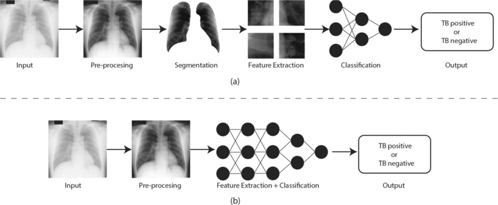
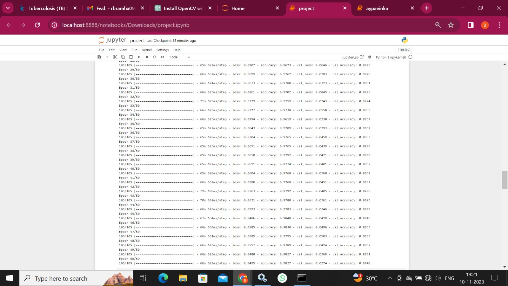
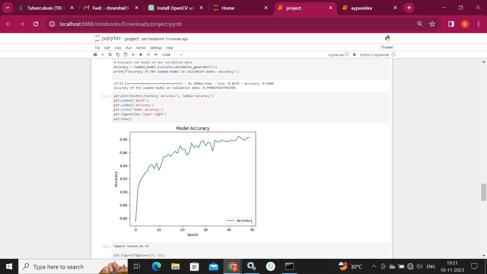
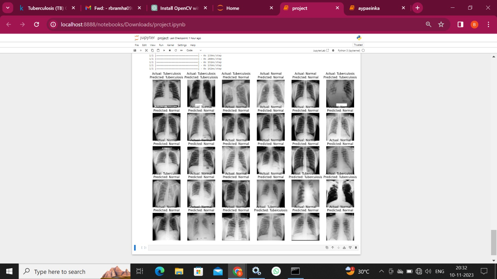
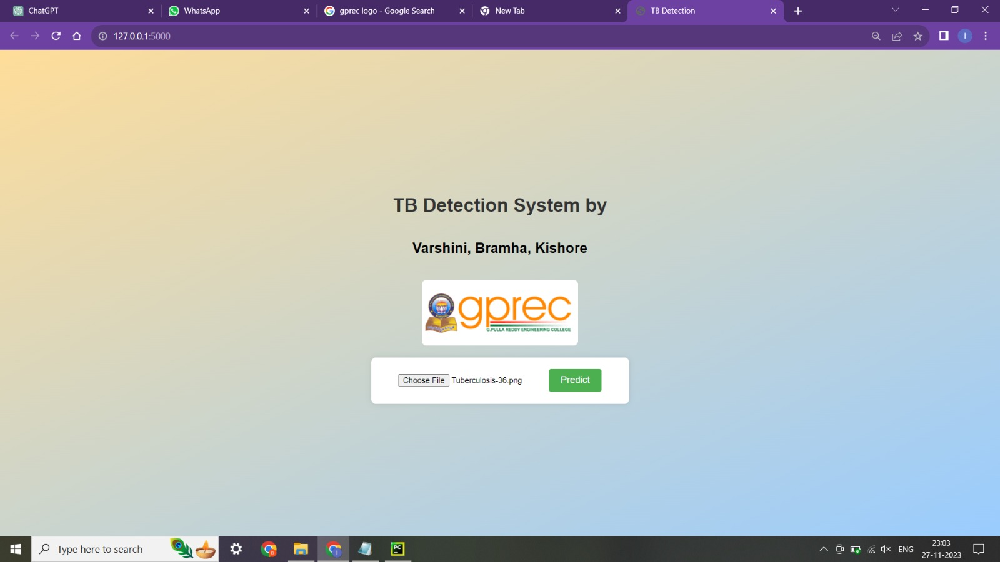
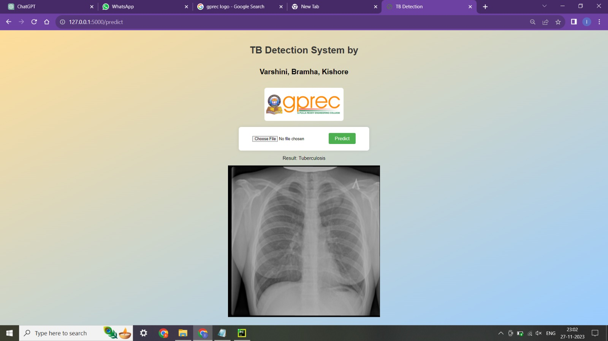
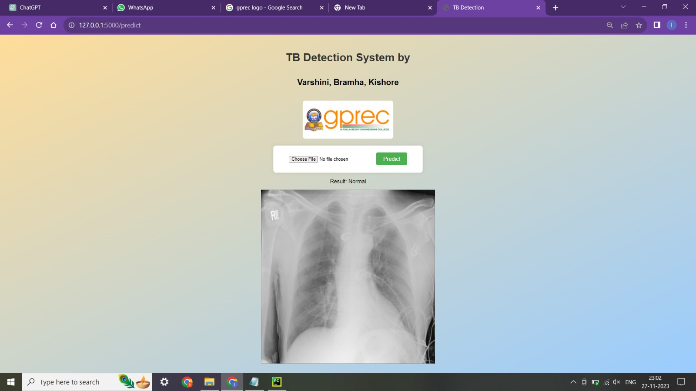
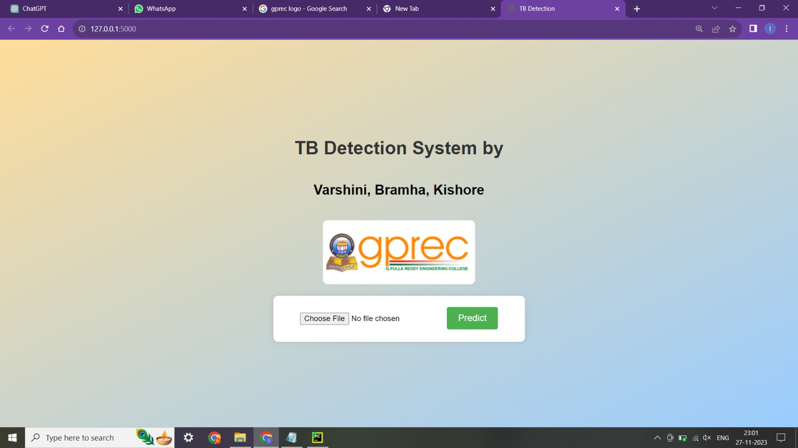

# Tuberculosis Detection Using CNN

A machine-learning project that classifies chest X-ray images into two categories: **Tuberculosis (TB)** and **Normal**. The project report describes a Convolutional Neural Network (CNN) trained on labelled chest X-ray images, with data augmentation, model evaluation, and a web interface for submitting an image and viewing a prediction.

> **Important medical disclaimer:** This is an academic project and is not a certified medical device. Its output must not be used to diagnose or rule out tuberculosis, or to make treatment decisions. Consult a qualified healthcare professional for clinical evaluation.

## Table of Contents

- [Project Overview](#project-overview)
- [Objectives](#objectives)
- [Workflow](#workflow)
- [Model and Training](#model-and-training)
- [Technology Stack](#technology-stack)
- [Repository Contents](#repository-contents)
- [Setup](#setup)
- [Dataset Preparation](#dataset-preparation)
- [Training and Evaluation](#training-and-evaluation)
- [Web Interface](#web-interface)
- [Results and Screenshots](#results-and-screenshots)
- [Limitations](#limitations)
- [Future Scope](#future-scope)
- [Team](#team)
- [References](#references)

## Project Overview

Tuberculosis is an infectious disease that commonly affects the lungs. Reading chest X-rays can require trained medical expertise, and access to timely screening may be limited in some settings. This project explores how CNN-based image classification can assist research into TB screening.

The model learns visual patterns from labelled chest X-ray images and predicts one of two classes:

- **Tuberculosis**
- **Normal**

The project report describes data preparation, image augmentation, CNN training, validation, saving and reloading the trained model, plotting training accuracy, and testing predictions on sample images.

## Objectives

- Develop a CNN model to classify chest X-ray images as TB or Normal.
- Prepare and shuffle image paths and class labels for model development.
- Use image augmentation to increase the diversity of training examples.
- Evaluate the trained model on a validation set.
- Save the trained model for subsequent loading and prediction.
- Present predictions through a user-facing interface.

## Workflow

The pipeline described in the project report is:

1. **Collect and prepare data** — organise chest X-ray images by class and create a table of image paths and labels.
2. **Augment training images** — apply transformations such as rotation, width/height shifts, horizontal flipping, shear, and zoom.
3. **Shuffle and split data** — prepare training and validation sets.
4. **Define and compile the CNN** — use convolution, max-pooling, flattening, and dense layers.
5. **Train the model** — train using the training set and validate during training.
6. **Save and reload the model** — the report specifies the filename `tbdetection.keras`.
7. **Evaluate and visualise** — inspect validation accuracy, training history, and predictions for sample images.



## Model and Training

According to the project report, the model uses the Keras Sequential API and includes:

- Convolutional layers to learn image features.
- Max-pooling layers to reduce spatial dimensions.
- A flatten layer to convert feature maps into a vector.
- Dense layers for classification.
- ReLU and sigmoid activation functions.
- The Adam optimizer.
- Binary cross-entropy as the loss function.
- Accuracy as the training metric.

The report specifies **20 training epochs** and the saved model name **`tbdetection.keras`**. Actual performance depends on the dataset, data split, runtime environment, and training configuration. Refer to the generated training output rather than assuming a particular accuracy value.

## Technology Stack

Technologies identified in the report:

- **Python**
- **TensorFlow / Keras** — CNN model and image data generators
- **Pandas** — organising image paths and class labels
- **Matplotlib** — plotting training history and displaying sample predictions
- **Jupyter Notebook** — interactive development and experimentation

The report also documents a web interface for uploading an X-ray image and viewing a predicted class. The specific web framework and launch command should be taken from the application files in this repository.

## Repository Contents

The following documentation assets are included with this README:

```text
.
├── README.md
    └── images/
        ├── methodology-flow.png
        ├── training-accuracy-graph.jpg
        ├── training-epoch-output.jpg
        ├── random-validation-predictions.jpg
        ├── web-interface-home.jpg
        ├── web-interface-xray-selected.jpg
        ├── prediction-result-tuberculosis.jpg
        └── prediction-result-normal.jpg
```


## Setup

### 1. Create a virtual environment (recommended)

**Windows:**

```bash
python -m venv .venv
.venv\Scripts\activate
```

**Linux / macOS:**

```bash
python3 -m venv .venv
source .venv/bin/activate
```

### 2. Install the Python libraries

If the repository already contains a `requirements.txt`, install its pinned dependencies:

```bash
python -m pip install -r requirements.txt
```

If no dependency file is present, the report indicates that the project uses the following core libraries; install compatible versions for your Python environment:

```bash
python -m pip install tensorflow pandas numpy matplotlib jupyter pillow
```

> TensorFlow compatibility varies by Python version and operating system. If installation fails, check the TensorFlow installation guide and use a supported Python version.

## Training and Evaluation

1. Open the existing Jupyter notebook in the repository, or launch Jupyter from the project root:

   ```bash
   jupyter notebook
   ```

2. Open the project's notebook and check the dataset paths before running cells.
3. Run the data preparation and augmentation steps.
4. Run the CNN model definition, compilation, and training cells.
5. Review the training output and accuracy graph.
6. Confirm that the model is saved as `tbdetection.keras` as described in the report.
7. Run the evaluation and sample-prediction cells.

The report describes a training/validation workflow. It does not provide a verified numerical accuracy figure in the extracted narrative, so this README intentionally does not claim a specific model accuracy.

## Web Interface

The project report includes screenshots of a web interface that allows a user to select a chest X-ray image and view a predicted class. To run it locally:

1. Check the repository for the web application entry-point file and its instructions.
2. Install the dependencies required by that application.
3. Confirm that the application points to the correct trained model file and applies the same image preprocessing used during training.
4. Start the application using the command documented in its source code.
5. Open the local URL printed by the application and upload a sample image.

The report alone does not identify the web framework or its exact startup command; those details should not be guessed.

## Results and Screenshots

### Training output



### Training accuracy graph



### Predictions on sample images



### Web application

**Home page**



**Input image selected**



**Prediction: Tuberculosis**



**Prediction: Normal**



The images above are taken from the supplied academic project report. They illustrate the reported workflow and interface; they are not a guarantee of clinical performance.

## Limitations

- The system is a student/research prototype, not a validated clinical diagnostic tool.
- Performance can vary with image quality, acquisition settings, patient population, and dataset composition.
- A model can produce false-positive and false-negative predictions.
- Validation results on a limited dataset do not establish generalisation to all hospitals or populations.
- A prediction should be interpreted only as an experimental model output, not as a medical conclusion.

## Future Scope

The project report identifies the following possible improvements:

- Explore additional input information, such as patient history or genomic data.
- Investigate real-time monitoring and continuous assessment.
- Improve model interpretability so that the factors influencing predictions can be examined.
- Evaluate performance across different geographical regions and populations.
- Conduct longitudinal studies to assess reliability over time.
- Explore classification of other respiratory diseases.

## Team

The project report lists the following contributors:

- **P. Varshini Reddy**
- **P. Brahma Reddy**
- **B. Lava Kishore Reddy**

**Project guide:** Dr. D. R. Srinivas, Associate Professor, Department of Electronics and Communication Engineering.

**Institution:** G. Pulla Reddy Engineering College (Autonomous), Kurnool  
**Academic year:** 2023–2024

## References

References listed in the project report include:

1. World Health Organization. *Global Tuberculosis Report 2020*.
2. Rajaraman, S., Candemir, S., Kim, I., Thoma, G., & Antani, S. (2017). *A Novel Stacked Generalization of Models for Improved TB Detection in Chest Radiographs*.
3. Lopes, F. M., & Mauad, F. M. (2019). *Tuberculosis Detection Using CNN Features from Chest X-ray Images*.
4. Jaeger, S., et al. (2014). *Automatic tuberculosis screening using chest radiographs*.
5. Gupta, D., & Prasad, M. (2018). *A survey on detection of tuberculosis using image processing techniques*.
6. Wang, S., Shi, W., & Li, Y. (2017). *Tuberculosis identification from chest X-rays by deep learning techniques*.

---

**For educational and research use only. Not for clinical diagnosis.**
